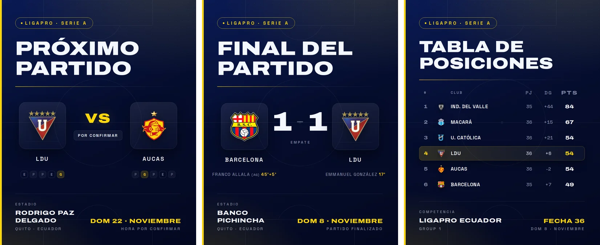

# LDU Auto

Generación y publicación automática de posts de Instagram sobre Liga Deportiva
Universitaria de Quito: anuncio del próximo partido, resultado final y tabla de
posiciones de la LigaPro.



Proyecto personal y no oficial, sin relación con Liga Deportiva Universitaria, la
LigaPro ni ESPN. Los nombres y escudos pertenecen a sus titulares.

## Qué publica

| Post | Contenido |
| --- | --- |
| Próximo partido | Rival, estadio, fecha y racha de los últimos cinco partidos de ambos equipos |
| Resultado final | Marcador y goleadores con su minuto, incluida la definición por penales |
| Tabla de posiciones | Tabla de la LigaPro tras cada fecha, solo cuando cambió |

Cada competición tiene su propio tema visual: LigaPro, Libertadores, Sudamericana,
Copa Ecuador, Supercopa Ecuador, amistosos y otras competiciones.

## Cómo funciona

1. Datos. La API pública de ESPN, gratuita y sin clave, aporta fechas, estadios,
   ciudades, escudos, marcadores y estado del partido en todas las competiciones
   configuradas en [src/config.js](src/config.js). Del resumen de cada partido salen
   los goleadores con su minuto y la forma reciente de ambos equipos, y del endpoint
   de standings, la tabla completa de la LigaPro. ESPN no cubre la Copa Ecuador ni la
   Supercopa, así que esos partidos vienen de TheSportsDB
   ([src/sportsdb.js](src/sportsdb.js)), también gratuita y sin clave.
2. Detección de cambios. [data/state.json](data/state.json) guarda qué se anunció y
   qué resultados ya se publicaron. Solo se generan posts cuando hay algo nuevo: un
   nuevo próximo partido, un cambio de fecha u hora o un partido recién terminado.
   La tabla se publica justo después de un resultado de LigaPro y solo si cambió
   desde la última vez. Si ESPN aún no la actualizó, queda pendiente
   (`standingsOwedSince`) y se reintenta en las ejecuciones siguientes durante un
   máximo de tres días.
3. Render. Cada post es una plantilla HTML
   ([src/templates/post.js](src/templates/post.js)) que Playwright convierte en un
   PNG de 1080 × 1350 con Chromium.
4. Publicación. Se usa la Instagram Graph API oficial. Las imágenes se guardan en el
   repositorio y se publican desde su URL pública de `raw.githubusercontent.com`.
5. Automatización. GitHub Actions ejecuta el proceso dos veces por hora, en los
   minutos 17 y 47 ([ldu-posts.yml](.github/workflows/ldu-posts.yml)). Como el cron
   de GitHub puede retrasarse horas, alrededor de cada partido actúa la vigilancia de
   partido ([src/watch.js](src/watch.js)). Desde 12 horas antes del inicio, la última
   ejecución dispara [ldu-wakeup.yml](.github/workflows/ldu-wakeup.yml), que espera
   hasta el final previsto, unos 105 minutos después del inicio, y relanza el
   proceso. Después repite cada 15 minutos hasta que el resultado, su cola y la
   tabla estén publicados, como máximo hasta 8 horas después del inicio.

## Tecnología

| Área | Herramientas |
| --- | --- |
| Lenguaje | JavaScript con Node.js |
| Datos | API pública de ESPN y TheSportsDB |
| Render | Plantillas HTML y Playwright con Chromium |
| Publicación | Instagram Graph API |
| Automatización | GitHub Actions |
| Pruebas | node:test |

## Uso local

```bash
npm install
npx playwright install chromium

npm run samples    # renderiza ejemplos de próximo partido, resultado, casos límite y tabla
npm run generate   # proceso real: datos de ESPN, comparación de estado, PNG y texto
npm test           # ejecuta las pruebas
```

Los posts quedan en `output/posts/`, cada uno como imagen PNG y texto `.txt`, y se
encolan en `data/pending.json` hasta que se publican.

## Configuración de la publicación en Instagram

La guía paso a paso, con soluciones a los problemas de inicio de sesión de Meta,
está en [docs/INSTAGRAM_SETUP.md](docs/INSTAGRAM_SETUP.md).

Hace falta una cuenta profesional de Instagram (Creator o Business) y una app en
[developers.facebook.com](https://developers.facebook.com) con el producto Instagram.
Se admiten los dos flujos oficiales: el nuevo inicio de sesión de Instagram (token
`IGAA…`, sin página de Facebook) y el clásico a través de Facebook (token `EAA…`).
El host de la Graph API se detecta automáticamente.

Secrets del repositorio, en Settings, Secrets and variables, Actions:

| Secret | Valor |
| --- | --- |
| `IG_USER_ID` | ID de la cuenta profesional de Instagram |
| `IG_ACCESS_TOKEN` | Token de acceso de larga duración |

La variable opcional `IMAGE_BASE_URL` permite servir las imágenes desde otro host.
Por defecto se usa la URL raw del propio repositorio, que por eso debe ser público
para que Instagram pueda descargar las imágenes.

Sin estos secrets el workflow sigue funcionando: genera y guarda los posts y los deja
en cola hasta que se configuren las credenciales.

## Estructura

```
src/
  config.js               equipo, ligas de ESPN, tipos de competición y hashtags
  espn.js                 cliente de ESPN: partidos, goleadores, forma y tabla
  sportsdb.js             cliente de TheSportsDB: Copa Ecuador y Supercopa
  state.js                estado persistente y planificación de posts
  watch.js                vigilancia del día de partido
  outcome.js              ganador de cada partido, compartido por imagen y texto
  templates/post.js       plantilla HTML de 1080 × 1350 con temas por competición
  templates/standings.js  plantilla de la tabla de posiciones de la LigaPro
  render.js               conversión de HTML a PNG con Playwright
  captions.js             textos en español por tipo de post y resultado
  publish.js              publicación con la Instagram Graph API
  cleanup.js              borrado de posts antiguos según un periodo de retención
  samples.js              partidos de ejemplo para previsualizar diseños
  index.js                orquestador: generate, publish, cleanup y samples
test/                     pruebas con node:test
docs/                     guía de Instagram e investigación previa
.github/workflows/        publicación, vigilancia de partido, renovación del token y diagnóstico
```
